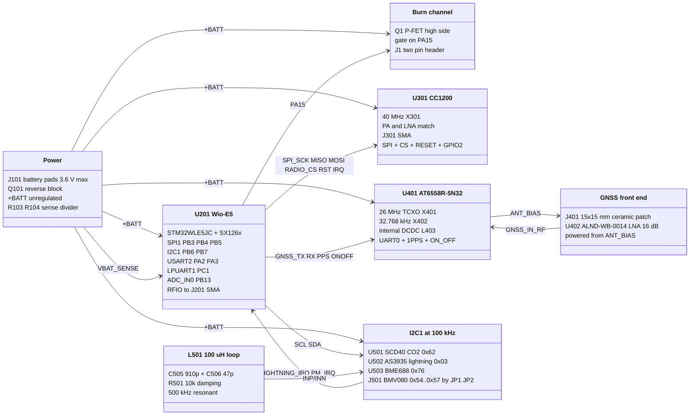

# Architecture

The sensor set comes from `Forest-Balloon.csv`.

## Components

## Sheets

| Sheet | Contents |
| --- | --- |
| `mcu.kicad_sch` | battery pads, reverse-block P-FET, sense divider, Wio-E5 and decoupling, reset, SWD and console pads, status LED, I2C pull-ups, LoRa SMA, burn FET and header, two mounting holes |
| `radio.kicad_sch` | CC1200, 40 MHz crystal, per-pin decoupling, loop filter, the v1 TX/RX matching network, SMA |
| `gnss.kicad_sch` | AT6558R-5N32, 26 MHz TCXO, 32.768 kHz RTC crystal, internal DCDC/LDO passives, ALND-WB-0014 LNA, ceramic patch antenna |
| `sensors.kicad_sch` | SCD40, AS3935 with its 500 kHz loop antenna, one BME688, BMV080 ZIF connector on I2C with address jumpers |

## Power

There is no regulator and no switch. The cell drives the whole board through
one P-channel FET:

`Q101` blocks a reversed cell: its source is on the load side, so the body
diode conducts battery to load and the channel shorts it out. The rail is
the cell minus one Rds(on) and follows the cell from full charge to cutoff.
`R103`/`R104` (100k/100k) put half of it on `PB13` for the ADC.

| | |
| --- | --- |
| Rail | `+BATT`, unregulated, 3.6 V maximum |
| Bulk on the rail | 43.5 uF nominal, 4.7 uF at the MCU and the GNSS, 10 uF at each of the three big sensor loads, 1 uF at each IC |
| Off-state drain | none possible: the board is live whenever the cell is connected |

## Wio-E5 pin map

| Pin | Net | Function |
| --- | --- | --- |
| 8 PB3 | `SPI_SCK` | SPI1 clock to the CC1200 |
| 7 PB4 | `SPI_MISO` | SPI1 MISO |
| 11 PB5 | `SPI_MOSI` | SPI1 MOSI |
| 26 PB14 | `RADIO_CS` | CC1200 chip select |
| 5 PB15 | `RADIO_RST` | CC1200 reset |
| 20 PB10 | `RADIO_IRQ` | CC1200 GPIO2 |
| 6 PA15 | `Net-(Q1-G)` | burn FET gate |
| 25 PB9 | `PM_IRQ` | BMV080 interrupt, open drain active low |
| 10 PB6 | `SCL` | I2C1 clock |
| 9 PB7 | `SDA` | I2C1 data |
| 23 PA0 | `LIGHTNING_IRQ` | AS3935 interrupt (wake-capable) |
| 19 PA2 | `GNSS_RX` | USART2 TX to the receiver, through 22R |
| 18 PA3 | `GNSS_TX` | USART2 RX from the receiver, through 22R |
| 27 PA10 | `GNSS_PPS` | 1PPS |
| 13 PC0 | `GNSS_ONOFF` | receiver sleep control |
| 12 PC1 | `DBG_TX` | LPUART1 console out, on the debug pads |
| 24 PB13 | `BATT_VSENSE` | ADC_IN0, 1:2 divider off `+BATT`; also the module's boot pin |
| 21 PA9 | `STATUS_LED` | green LED through 1 k |
| 15 RFIO | `LORA_RF` | `J201`, the module's own sub-GHz radio |

CC1200 GPIO0 and GPIO3 go to test pads `TP301`/`TP302`. GNSS SWD is on
`TP401`/`TP402`.

## Interfaces

| Ref | Part | Carries |
| --- | --- | --- |
| `J101` | two 2 x 4 mm solder pads, 3 mm pitch, back side | battery leads |
| `J202` | six 1.27 mm solder pads, back side | `+BATT` GND SWDIO SWCLK NRST DBG_TX |
| `J1` | 2-pin 1.00 mm header, front side | burn wire, switched high side |
| `J201` `J301` | Samtec SMA-J-P-H-ST-EM1 edge launch | LoRa and CC1200 antennas |
| `J401` | AC33154-1T patch, pin fed through the board | GNSS, back side |
| `J501` | Kyocera 6844 0.30 mm 13-way ZIF | BMV080 flex; the sensor lies along the bottom edge |
| `JP1` `JP2` | 3-pad solder jumpers | BMV080 I2C address bits; open by default, which the sensor does not allow |
