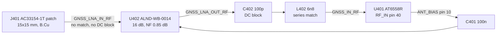
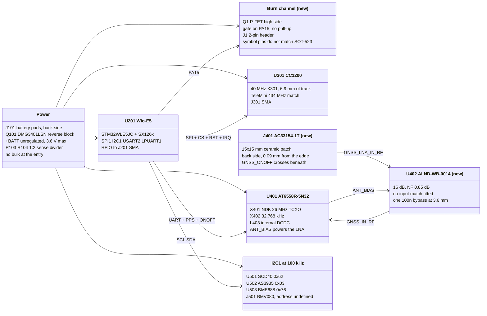

# Board review: cc1200-balloon

Reviewed 2026-09-20 against commit `3c0c6dd` ("Add PMOS.") plus the two
untracked footprints in the working tree. Four-layer 50 x 30 mm board, 106
placements, routed. Everything below was measured from the files on disk and
checked against the manufacturers' data sheets. `sheets/*.json` was ignored
throughout; it has not described this design since 2026-09-06.

Three things changed since the 2026-09-15 review and all three are the
subject of new findings: the GNSS front end became an on-board ceramic patch
plus an Abracon LNA, the TCXO was re-sourced, and a P-FET burn/cutdown
channel was added on `PA15`.

## 1. Verdict

The GNSS front end rework is the right idea and mostly correct, but it went
onto the board without its matching network and with the patch hanging off
the board edge. The new burn channel is wired from a SPICE simulation symbol
whose pin numbering is the reverse of every real SOT-523 MOSFET, and its gate
has nothing holding it off. Five items block fabrication.

| # | Severity | Item | Fix |
| --- | --- | --- | --- |
| 1 | blocking | `Q1` uses `Simulation_SPICE:PMOS` (pins 1=D, 2=G, 3=S) on a SOT-523 land; every real SOT-523 MOSFET is 1=G, 2=S, 3=D, so `+BATT` lands on the drain, the burn load on the gate and `PA15` on the source | choose a real part, replace the symbol, re-check the three pads |
| 2 | blocking | `Q1` gate net has two nodes, `Q1.2` and `U201.6`; nothing holds a high-side P-FET off while the MCU is in reset | 100 k gate pull-up to `+BATT`, 1 k in series to `PA15` |
| 3 | blocking | The `ALND-WB-0014` LNA has no input match; the data sheet requires a high-Q 8.2 nH in series at `RFIN` and the patch feed goes straight into the pin | add the 8.2 nH in series on `GNSS_LNA_IN_RF` |
| 4 | blocking | `J401` 15 x 15 mm patch body reaches x = 75.09 against a board edge at x = 75.00; its courtyard crosses the edge and its silkscreen is clipped | move the patch inboard, or widen the board |
| 5 | blocking | `C512`, `C513`, `C515` are valued `10u` but carry `LMK105BJ105KVHF`, the **1 uF** part used everywhere else; rail bulk is 43.5 uF as drawn and 16.5 uF as ordered | set the MPN to a real 10 uF part and add it to `tools/parts.json` |
| 6 | major | `GNSS_ONOFF` runs 18.9 mm on `B.Cu` under the patch, 12.65 mm of it straight through the middle of the radiator | reroute outside the patch outline |
| 7 | major | `X401` NDK `NSC5351B-26M` is rated 1.7 to 3.3 V and is fed from `VX_OUT`, specified 2.7 to 3.6 V | accept 3.3 to 3.6 V as out of window, or pick a 3.6 V TCXO |
| 8 | major | LNA bypass is one 100 nF 3.57 mm from `U402` pin 2; the evaluation board shunts 1 uF and 1 nF on VCC and 1 nF on EN, all at the part | 1 nF at the pad, keep the 100 nF as bulk |
| 9 | major | `U402` pads 1 and 4, both GND, each reach the pour through one thermal spoke | solid connection, ground via at each pad |
| 10 | major | `C107` body overlaps the Wio-E5 body by 0.08 x 0.50 mm; `R103` clears it by 0.08 mm | move both clear of x = 118.88 |
| 11 | major | 28 unique DRC errors, 13 of them clearance in the GNSS RF corner | see section 6 |
| 12 | major | Exposed-pad stitching unchanged: `U301` 4 vias, `U401` 4, `U501` 3, `U502` 1 | 3 x 3 in `U301` and `U401` |
| 13 | major | CC1200 crystal and RF chain unchanged from the last review; LNA legs still unbalanced by 2.67 mm | `LAYOUT_PRIORITY.md` items 6, 7, 9 |
| 14 | major | No bulk at the battery entry; nearest is `C202` 4.7 uF at 19.2 mm from `Q101` | 22 uF at `Q101` source |
| 15 | minor | Burn current runs through 7.5 mm of 0.2 mm track and one 0.3 mm via; `J1` pads sit at 0.15 mm | widen, stitch, set a local clearance on `J1` |
| 16 | minor | `H101`/`H102` hole clearances, `H102` over `D201`, and both holes on the top edge only | move vias, add bottom-edge support |
| 17 | minor | Patch plus 16 dB LNA is below the AT6558R's recommended 18 to 35 dB of external gain | accept, or a higher-gain LNA |
| 18 | minor | BMV080 address jumpers still open, `VDDL` still out of window, `JP1`/`JP2` legends still swapped | carried from 2026-09-15, items 2, 3, 10 |
| 19 | minor | Six symbols unresolved by the BOM tools, so `digikey_bom.csv` and `BOM.md` cannot be regenerated and are stale | add the six to `tools/parts.json` |

ERC is clean apart from two `lib_symbol_mismatch` warnings on `JP1`/`JP2`.
Schematic parity is exact: 0 unconnected items, 0 parity issues, no orphan
footprints.

## 2. The burn channel

`Q1` is new, and it is the most dangerous item in this review because the
failure mode is an unintended cutdown.

```
+BATT -- Q1 (P-FET high side) -- J1.1 -- burn wire -- J1.2 -- GND
                  |
                PA15
```

**Item 1, the pin mapping.** The symbol is `Simulation_SPICE:PMOS`. Its
`Sim.Pins` property reads `1=D 2=G 3=S`, and the symbol's pins are numbered
to match. It is a simulation primitive, not a transistor, and it carries no
MPN, no manufacturer and no orderable part.

The land is `Package_TO_SOT_SMD:SOT-523`, whose pads 1 and 2 are the pair on
one side and pad 3 is the lone pin on the other. On every real SOT-523
MOSFET the lone pin is the drain. The Diodes DMG1013T data sheet top view
shows D alone on one side with G and S facing it, giving the usual 1 = G,
2 = S, 3 = D. So the board as routed would connect:

| Board pad | Net today | What a real part puts there |
| --- | --- | --- |
| 1 | `Net-(J1-Pin_1)`, the burn load | Gate |
| 2 | `Net-(Q1-G)`, `PA15` | Source |
| 3 | `+BATT` | Drain |

Nothing about this arrangement works. Pick the part first, then redraw the
symbol from its data sheet.

**Item 2, the floating gate.** `Net-(Q1-G)` has exactly two nodes: `Q1.2` and
`U201.6`. There is no pull-up. A P-channel high-side switch is on whenever
its gate is more than a threshold below its source, and an MCU pin that has
not been configured yet is an input.

`PA15` on the STM32WLE5 is JTDI, which comes out of reset with an internal
pull-up, so in the normal case the gate is held near `+BATT` and the FET is
off. That is a mitigation, not a design. It does not cover the supply ramp
before the core releases reset, it does not cover a firmware that
reconfigures the SWJ pins, and it puts a pyrotechnic-class output behind an
undocumented internal resistor.

```mermaid
gantt
    title Q1 gate state from cell connection, milliseconds
    dateFormat x
    axisFormat %L
    section Rail
    +BATT ramps at Q101           :0, 2
    +BATT stable                  :2, 60
    section Gate as drawn
    undefined, FET may conduct    :crit, 0, 12
    held by the PA15 pull-up      :active, 12, 60
    section Gate with a 100k pull-up
    tracks the rail, FET off      :done, 0, 60
```



Add a 100 k from gate to `+BATT` and 1 k in series to `PA15`. The pull-up
costs 36 uA only while the FET is commanded on.

**Item 15, the current path.** `Net-(J1-Pin_1)` is 7.48 mm of 0.2 mm track,
and the `+BATT` feed reaches `Q1` pin 3 through 0.68 mm of 0.6 mm track and a
single 0.6/0.3 mm via. A 0.2 mm outer-layer track in 1 oz copper carries
about 1.1 A at a 10 C rise. Nichrome cutdown loops usually want 1 to 3 A.
Everything also passes through `Q101`, which is fine for a short pulse but
should be stated. `J1` is a 1.0 mm pitch header whose 0.85 mm pads sit
0.15 mm apart, against a 0.2 mm netclass rule; that is inherent to the
footprint and needs a local clearance override or a different connector.

There is no series fuse, no current limit and no documentation of the
intended load anywhere in the repository. Size the trace and the via to the
wire before ordering.

## 3. The GNSS front end

The SMA jack and the off-board active antenna are gone. In their place:
`J401`, a 15 x 15 mm ceramic patch on the back of the board, feeding `U402`,
an Abracon `ALND-WB-0014` LNA on the front, into the AT6558R.



### What is right

- **Pinout.** `U402` pins 1 GND, 2 VCC, 3 RFOUT, 4 GND, 5 RFIN, 6 EN match
  the data sheet pin table exactly, and the land pattern in
  `lib/cc1200_balloon.pretty/Abracon_DFN-6_1.1x0.7mm.kicad_mod` is the
  data sheet's own 6 x 0.25 mm pads on a 0.4 mm grid.
- **The bias-T is correctly gone.** With the DC no longer on the RF line
  there is nothing for the 33 nH choke to block, so deleting `L401` was
  right. `ANT_BIAS` now powers the LNA directly, and the numbers work: the
  chip's antenna-detect threshold is 2.5 mA and the LNA draws 5.26 mA
  typical, so detection reads "antenna present"; short-circuit protection
  trips at 45 to 60 mA; the detect circuit's drop is 0.3 V at 50 mA, so
  about 30 mV here.
- **Sleep behaves.** Section 8.6's power table turns the antenna supply off
  when `ON_OFF` is low, so the external LNA powers down with the receiver
  instead of drawing 5 mA through the flight.
- **EN tied to VCC** is legal: logic high is 1.2 V minimum, absolute maximum
  4.0 V.
- **The output DC block is present.** `C402` 100 pF keeps DC off `RF_IN`,
  which the data sheet caps at 1.2 V.

### Item 3: the input match is missing

Note 1 under the electrical specification says "input matched to 50 ohms
using a high quality-factor 8.2nH inductor". The evaluation board schematic
on page 7 of the data sheet settles the topology, read at 600 dpi:

```
J2 (source) ---- L1 8.2 nH ---- RFIN pin 5
                 in series

RFOUT pin 3 ---- J1                  no DC block anywhere in the RF path
VCC pin 2 ---- C3 1 uF ---- GND      both shunt
          ---- C1 1 nF ---- GND
EN  pin 6 ---- C2 1 nF ---- GND      shunt
```

So there is exactly one element in the signal path and it is **an 8.2 nH in
series ahead of `RFIN`**. The three capacitors in the evaluation board BOM
are all shunt bypasses: `C1` and `C3` on VCC, `C2` on EN. None of them is a
series DC block, and the board ships without one on either RF port.

On this board the patch feed runs 1.41 mm of 0.2 mm track straight into pin
5 with nothing in it. Without the match the LNA input is not 50 ohm, so the
0.85 dB noise figure and 16 dB gain in the table do not apply, and this sits
at the very front of the receive chain where a tenth of a dB of mismatch
loss is a tenth of a dB of sensitivity.

**No input DC block is needed here**, despite the data sheet's note about
100 pF at both ports. That note is conditional on DC existing in the signal
path, which is the case when the LNA feeds or is fed through a bias-T. On
this board `ANT_BIAS` goes to the LNA's VCC and EN pins and never touches
the RF line, and the patch feed pin is a DC open, so there is no DC to
block. The 100 pF on the output, `C402`, is still right and still required:
it keeps the LNA's output bias off `RF_IN`, which the AT6558R limits to
1.2 V DC.

Sourcing. The evaluation board's `LQW15AN8N2J00D` is reel-only at DigiKey.
Same series, same electrical specification, in cut tape:

| MPN | DigiKey | Tolerance | Q at 250 MHz | DCR | Stock | Unit at 1 |
| --- | --- | --- | --- | --- | --- | --- |
| `LQW15AN8N2H00D` | 490-6850-1-ND | 3 % | 25 | 140 mOhm | 2864 | $0.11 |
| `LQW15AN8N2J8ZD` | 490-15592-1-ND | 5 % | 32 | 69 mOhm | 9249 | $0.15 |

The first is the direct equivalent and matches the `LQW15AN` parts already
on the board. The second is the higher-Q variant of the same size, and
since the data sheet asks for a high quality factor at the one place in the
chain where loss costs noise figure one for one, it is the better buy for
four cents.

Placement is the hard part, not the part number. `J401` pad to `U402`
pin 5 is 2.35 mm center to center on a diagonal, which does not fit an 0402
in series without reworking that corner. The corner already has ten
clearance errors, so do both at once.

### Item 4: the patch overhangs the board edge

| Measurement | Value |
| --- | --- |
| Patch body | x 75.09 to 90.09, y 91.23 to 106.23 |
| Board outline | x 75.00 to 125.00, y 85.00 to 115.00 |
| Margin, left | 0.09 mm |
| Margin, top / bottom | 6.23 mm / 8.77 mm |
| Courtyard, left | x 74.89, 0.11 mm outside the board |

The silkscreen is already clipped by the edge in three places, which is what
DRC is reporting. Mechanically the ceramic will sit flush with or slightly
proud of the edge, with its 3M 9448A adhesive pad partly unsupported.

Electrically it is worse. The data sheet characterizes the antenna on a
50 x 50 mm ground plane, and every number in the RF table (VSWR 1.2, peak
gain 2.1 dBi, 57 % efficiency) is measured there. This board is 50 x 30 mm
and the patch has essentially no ground plane on one side. Expect the
resonance to move off 1575 MHz and the pattern to tilt away from the short
side. Nothing on the board can tune that out.

### Item 6: a control line crosses the antenna ground

`GNSS_ONOFF` is routed on `B.Cu`, the same layer the patch is mounted on,
and 18.9 mm of it lies inside the patch outline, including one run from
(84.7, 103.4) to (84.7, 90.75) that crosses the radiator end to end 1.9 mm
from its center. The slot it cuts in the pour is directly under the patch.

Move it to `F.Cu` or around the patch footprint. It is a sleep control line
with no timing constraint, so the detour is free.

### Item 8: LNA bypassing

`C401` 100 nF is 3.57 mm from `U402` pin 2. At 1.575 GHz an 0402 100 nF is
well above its self-resonance and 3.6 mm of track adds about 3 nH in series.
The pin is effectively unbypassed at the operating frequency, which for a
16 dB gain block is how you get instability and supply-coupled spurs. The
evaluation board shunts 1 uF and 1 nF on VCC and another 1 nF on EN, all
beside the part. Put a 1 nF within 1 mm of pin 2 and leave `C401` where it
is as bulk. EN is tied to VCC here, so one cap serves both.

### Item 17: gain budget

Section 8.2 of the AT6558R data sheet asks for 18 to 35 dB of gain in the
external antenna unit. The LNA is 16 dB typical, 15 dB minimum, and the
match and trace losses come off that. This is below the recommendation
rather than outside a hard limit, and the receiver will work, but there is
no margin for the missing input match to eat.

## 4. The TCXO

The blocking defect from the last review is fixed. `X401` pin 1 is no longer
tied to `VX_OUT`.

The part is now the NDK `NSC5351B-26M` (NT2520SE family), and the wiring
matches its terminal table exactly: pins 1 and 3 to GND, pin 4 the output,
pin 6 Vcc, pins 2 and 5 unconnected. The data sheet's mandatory 1000 pF
output DC-cut capacitor is present as `C416`, in series between pin 4 and
`XREF`. Output level is 0.8 Vpp minimum against the chip's 0.5 to 1.5 Vpp
`XREF` window, and stability is 0.5 ppm over -40 to +105 C, which meets
section 8.4's request for better than 0.5 ppm.

The footprint is the stock Kyocera 2520 6-pin land. Compared against the
NDK recommended land it matches on every dimension except the outer pad
length, 0.825 mm here against 0.95 mm recommended, with the difference taken
off the inboard end. That is a usable land, not a defect.

**Item 7.** The NDK part is specified 1.7 to 3.3 V, typical 1.8 V, absolute
maximum 4.6 V. It is powered from `VX_OUT`, which the AT6558R pin table
gives as 2.7 to 3.6 V. On a fresh cell the TCXO runs roughly 0.3 V above its
recommended maximum. It will not be damaged, and the frequency/voltage
coefficient is only 0.2 ppm for a 5 % supply change, but the part is out of
its specified window for the first part of every flight. Either accept that
in writing or choose a TCXO rated to 3.6 V.

Two smaller notes from the same data sheet: it asks for a 0.01 uF bypass
close to the product, and `C412` 100 nF is 3.0 mm from pin 6 and 1.43 mm
from the chip, so it is bypassing the wrong end; and it asks for ground
under the oscillator for frequency establishment, which the `F.Cu` pour
provides.

## 5. Power and the bill of materials

### Item 5: three capacitors have the wrong part number

| Ref | Value on the symbol | MPN on the symbol | What that MPN is |
| --- | --- | --- | --- |
| `C512` | 10u | `LMK105BJ105KVHF` | 1 uF 0402, the part used for all eight 1u lines |
| `C513` | 10u | `LMK105BJ105KVHF` | same |
| `C515` | 10u | `LMK105BJ105KVHF` | same |

The three were added to give the AS3935, the SCD40 and the BMV080 local
bulk, and they are placed correctly for that: `C512` 1.30 mm from `U502`
pin 5, `C513` 2.73 mm from `U501` pin 19, `C515` 2.47 mm from `J501` pin 8.
The intent is right and the placement is right; only the ordering
information is wrong, and it is wrong in the direction that fails quietly.

Rail bulk on `+BATT`, counting every capacitor on the net:

| | Nominal |
| --- | --- |
| As drawn | 43.49 uF |
| As the BOM would be ordered | 16.49 uF |

Derate for DC bias on top of that. A 6.3 V 0402 10 uF X5R at 3.6 V keeps
roughly a fifth of its value, so the honest effective figure is a few
microfarads either way.

**Item 14** is unchanged from the last review: there is still nothing at the
battery entry. The nearest capacitance to `Q101` pin 2 is `C202` 4.7 uF at
19.16 mm. The SCD40 pulls 205 mA peaks and the CC1200 up to 120 mA in
transmit, from a bobbin cell with ohms of internal resistance, through
19 mm of plane. Put 22 uF at the source pad.

### Item 19: the BOM tools no longer run

`python3 tools/set_part_fields.py --check` reports six symbols it cannot
resolve, so `tools/gen_digikey_bom.py` stops before writing anything:

| Ref | Reason |
| --- | --- |
| `Q1` | no part for `PMOS` in `Package_TO_SOT_SMD:SOT-523` |
| `J1` | no part for `Conn_01x02` in `PinHeader_1x02_P1.00mm_Vertical` |
| `X401` | MPN `NSC5351B-26M` is not in `parts.json` |
| `U402` | MPN `ALND-WB-0014-T` is not in `parts.json` |
| `C416` | no part for `1n0` in `Capacitor_SMD:C_0402_1005Metric` |
| `J401` | MPN `AC33154-1T` is not in `parts.json` |

`digikey_bom.csv` and `BOM.md` are therefore stale by five lines: they still
list three Samtec SMA jacks, the Abracon `AANI-AP-0158-1` off-board antenna
and the Pletronics TCXO, none of which are on the board any more, and they
are missing everything in the table above.

All four new parts are stocked in cut tape or tray at DigiKey, so the table
entries are straightforward:

| MPN | DigiKey | Packaging | Stock | Unit at 1 |
| --- | --- | --- | --- | --- |
| `NSC5351B-26M` | 644-NSC5351B-26MCT-ND | Cut Tape | 560 | $1.93 |
| `ALND-WB-0014-T` | 535-ALND-WB-0014-TCT-ND | Cut Tape | 4927 | $0.38 |
| `AC33154-1T` | 5350-AC33154-1T-ND | Tray | 998 | $2.45 |
| 10 uF 0402 6.3 V | 490-GRM155R60J106ME15JCT-ND | Cut Tape | 35790 | $0.17 |

Dropping three $2.65 SMA jacks and the $7.26 antenna and adding these takes
about $12 off the board. The 1000 pF C0G 0402 for `C416` is reel-only in the
Murata `GRM1555C1H102JA01D`; pick a cut-tape equivalent.

## 6. DRC, ERC and parity

Run with zones refilled, all track errors and schematic parity on. KiCad
reports the same violation once per copper layer, so the 42 raw entries are
28 distinct faults.

| Type | Unique | Where |
| --- | --- | --- |
| clearance | 13 | 10 in the GNSS RF corner, 1 at `J101`, 4 raw at `J1` counted once |
| starved_thermal | 7 | `U402` pads 1 and 4, `C302`, `C307`, `C319`, `C407`, `L307` |
| courtyards_overlap | 4 | `C107`, `R103`, `R104` against `U201`; `H102` against `D201` |
| hole_clearance | 3 | GND vias into `H101` and `H102` |
| silk_edge_clearance | 1 | `J401` silkscreen clipped, 3 segments |

The ten GNSS clearance errors are all the same thing: tracks routed at
0.2 mm against the `RF` netclass rule of 0.3 mm, between `GNSS_ANT_BIAS`,
`GNSS_LNA_IN_RF`, `GNSS_LNA_OUT_RF`, `GNSS_IN_RF`, `GNSS_VDD_RF` and
`GNSS_VDD_PLL`, plus two where `GNSS_IN_RF` passes 0.285 mm from `C411`.
That corner is congested because the LNA, the patch feed, the RF input and
four LDO outputs all converge there. It needs replanning, not nudging.

`J101` pad 1, the battery positive pad, sits 0.10 mm from a GND via against
a 0.2 mm rule. That one is a short waiting to happen on a hand-soldered
battery lead; move the via.

The two ERC warnings are `lib_symbol_mismatch` on `JP1` and `JP2`, carried
from the last review. "Update Symbols from Library" clears them.

Parity is exact, which is worth stating: 0 unconnected items, 0 parity
issues, and the three orphan mounting holes from the last review are gone.
`H101` and `H102` are both in the schematic and both inside the outline now.

## 7. Placement measurements

### CC1200

Every supply pin has a 47 nF within 2.04 mm, which is the number that
matters; the refdes-to-pin assignment in `SCHEMATIC_REVIEW.md` section 5 was
never followed, but the ring is correct.

| Pin | Function | Nearest cap | Distance |
| --- | --- | --- | --- |
| 1 | VDD_GUARD | `C302` | 1.51 mm |
| 5 | DVDD | `C301` | 1.53 mm |
| 12 | DVDD | `C308` | 1.79 mm |
| 13 | AVDD_IF | `C307` | 1.59 mm |
| 15 | AVDD_RF | `C307` | 1.23 mm |
| 22 | AVDD_SYNTH1 | `C306` | 1.75 mm |
| 25 | AVDD_PFD_CHP | `C304` | 1.77 mm |
| 27 | AVDD_SYNTH2 | `C304` | 1.74 mm |
| 28 | AVDD_XOSC | `C303` | 1.69 mm |

`C307` serves pins 13 and 15 and `C304` serves 25 and 27, while `C308` and
`C309` both crowd pin 12. Nine caps were bought for nine pins; move `C309`
onto pin 13 and one of the pair onto pin 25.

**Item 13**, the RF chain and the crystal, is unchanged since 2026-09-15:

| Part | To | Now | Target |
| --- | --- | --- | --- |
| `X301` pin 1 | `U301` pin 30 | 4.50 mm | 2.5 mm |
| `X301` pin 3 | `U301` pin 31 | 5.08 mm | 2.5 mm |
| `C318` | pin 30 | 3.33 mm | between crystal and pin |
| `C319` | pin 31 | 1.62 mm | ok |
| `L301` | pin 17 `PA` | 4.42 mm | 1.5 mm |
| `C323` | pin 18 `TRX_SW` | 3.75 mm | 1.5 mm |
| `L307` | pin 19 `LNA_P` | 1.43 mm | ok |
| `L308` | pin 20 `LNA_N` | 4.10 mm | match `L307` within 0.3 mm |
| `C325` / `C326` | pins 19 / 20 | 4.17 / 4.37 mm | 2 mm |
| `R301` | pin 14 `RBIAS` | 3.22 mm | 2 mm |

The differential LNA legs are 1.43 mm on P against 4.10 mm on N. That
imbalance converts common-mode noise into differential signal and no amount
of value tuning fixes it. `XOSC_Q1` and `XOSC_Q2` are 6.09 and 6.24 mm of
track on a node whose phase noise multiplies to the carrier by 20.7 dB.

### GNSS

| Part | To | Distance |
| --- | --- | --- |
| `C407` 1u | `U401` pin 1 `VDD_ANA` | 1.44 mm |
| `C408` 1u | pin 5 `VDD12BK` | 1.24 mm |
| `C409` 1u | pin 24 `VDD12BB` | 1.49 mm |
| `C410` 1u | pin 38 `VDD_PLL` | 1.73 mm |
| `C411` 1u | pin 39 `VDD_RF` | 1.53 mm |
| `C412` 100n | pin 2 `VX_OUT` | 1.43 mm |
| `C413` 100n | pin 6 `VDD_BK` | 1.33 mm |
| `C405` 100n | pin 7 `VDD_IO` | 1.66 mm |
| `C404` 4u7 | pin 21 `DX_IN` | 1.93 mm |
| `C406` 4u7 | pin 23 `VCORE` | 3.50 mm |
| `L403` 4u7 | pin 22 `DX_OUT` | 1.57 mm |
| `X402` | pins 11 / 12 RTC | 2.48 / 2.47 mm |
| `C403` 100n | pin 7 `VDD_IO` | 7.36 mm |

The LDO decoupling is good. `C403` is 7.36 mm from the pin it nominally
serves and 2.87 mm from `DX_IN`; treat it as rail bulk, not as `VDD_IO`
decoupling, or move it.

### Exposed pads

| Part | Pad | Vias in the pad |
| --- | --- | --- |
| `U301` CC1200 | 3.45 mm | 4 |
| `U401` AT6558R | 3.40 mm | 4 |
| `U501` SCD40 | 4.80 mm | 3 |
| `U502` AS3935 | 2.70 mm | 1 |

`LAYOUT_PRIORITY.md` puts the CC1200 exposed pad at rank 1, ahead of every
other length on the board, because it defines what "short" means for the
seventeen items under it. One via in the AS3935 pad is the worst of the
four.

### Stackup and zones

`F.Cu` / `In1.Cu` / `In2.Cu` / `B.Cu`, 0.1 mm prepreg, 1.24 mm core,
1.6 mm total. `In1.Cu` is a single unbroken GND polygon over the whole
board, which is what the RF depends on. `In2.Cu` carries the `+BATT` zone
inside the GND zone and is fragmented into 136 polygons, which is expected.
All 636 track segments are on `F.Cu` and `B.Cu`, so neither plane is cut by
routing. 290 vias, all 0.6/0.3 mm, 208 of them GND. Vias are tented both
sides.

## 8. Architecture as built



One BME688 is fitted, not two. The schematic and the board both carry
`U503` alone; `U504` is gone. `README.md` still describes two.

## 9. Carried over unfixed

From the 2026-09-15 review, still open and still correct as written there:

- **BMV080 address pins float.** `JP1`/`JP2` are `SolderJumper_3_Open`. The
  data sheet is explicit: "These pins cannot be left floating; if left
  floating the I2C address will be undefined!" The selection latches at
  power-up and cannot be changed afterwards.
- **BMV080 `VDDL` wants 3.3 V +-5 %** and gets the cell.
- **`JP1`/`JP2` legends are swapped.** The data sheet assigns `MISO` to IAB0
  and `CSB` to IAB1. The netlist has net `IAB0` on `J501.4` `CSB` through
  `JP1`, labeled IAB0, and net `IAB1` on `J501.11` `MISO` through `JP2`.
  Both names are on the wrong pin.
- **`L501`, the AS3935 500 kHz loop, is 9.8 mm from `L403`,** the GNSS DC-DC
  inductor.
- **`PB13` is both `BATT_VSENSE` and the module boot pin.** The divider
  holds it at half the rail, well above the threshold, so this is a note
  rather than a fault.

## 10. Order of work

1. Choose the burn FET, redraw `Q1` from its data sheet, add the gate
   pull-up and the series resistor, widen the drain path.
2. Move the patch inboard far enough to leave ground plane on all four
   sides, then reroute `GNSS_ONOFF` out from under it.
3. Add the series 8.2 nH at `RFIN` and the 1 nF at pin 2; replan the GNSS RF
   corner to clear the ten clearance errors while you are in there, since
   the inductor does not fit in the 2.35 mm it has today.
4. Fix the three 10 uF part numbers and add 22 uF at `Q101`.
5. Move `C107` and `R103` clear of the Wio-E5 body, and the vias out of the
   mounting holes.
6. Stitch the exposed pads, then take `LAYOUT_PRIORITY.md` items 6, 7 and 9
   on the CC1200 block.
7. Add the six missing parts to `tools/parts.json` and regenerate the BOM.
8. Decide in writing whether the TCXO may run at 3.6 V and whether the
   BMV080 gets a regulator.
