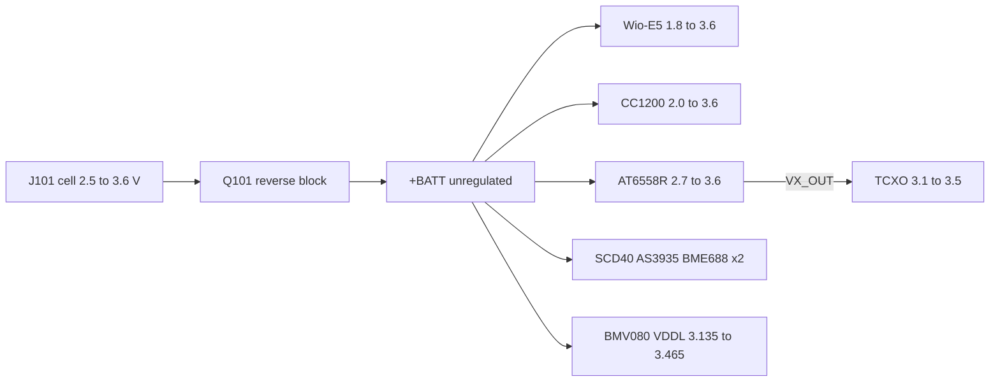

# Board review: cc1200-balloon

Reviewed 2026-09-15 against commit `65ec5d5` plus the working tree (the
routed four-layer board, 50 x 30 mm). Everything below was checked against
the files on disk and the manufacturers' data sheets, not against
`sheets/*.json`, which no longer describes the design (see section 7).

## 1. Verdict

The schematic is electrically sound except for one wiring error on the
GNSS TCXO, and the board is routed, DRC-clean apart from six cosmetic
errors, and in parity with the schematic apart from three parked mounting
holes. Three items must be fixed before fabrication, five should be, and
the rest are notes.

| # | Severity | Item | Fix |
| --- | --- | --- | --- |
| 1 | blocking | `X401` pin 1 is tied to `VX_OUT`; on every candidate TCXO that pin is GND or NC, and the named Kyocera part is a 6-pad package that does not fit the 4-pad footprint | disconnect pin 1 from `GNSS_VX`, tie to GND; MPN changed to Pletronics UCF4031035LK005000-26MDK |
| 2 | blocking | BMV080 I2C address pins `CSB`/`MISO` float: `JP1`/`JP2` are open by default and the data sheet says a floating pin gives an undefined address | use the bridged-by-default 3-pad jumper, or add 100k pull-downs |
| 3 | blocking | BMV080 laser supply `VDDL` needs 3.3 V +-5 %; the rail is the cell, 2.5 to 3.6 V; only one 1 uF serves three supply pins that each want more than 1 uF | dedicated 3.3 V LDO for the sensor, or accept out-of-window operation; restore per-pin 1 uF and the 100 nF on `VDDIO` |
| 4 | major | Rail bulk capacitance fell from 76 uF to about 12 uF nominal (about 5 uF at 3.6 V DC bias); the SCD40 draws 205 mA peaks and the CC1200 up to 120 mA in TX from a cell with ohms of internal resistance | restore 22 uF 0805 at the battery entry and at the SCD40 |
| 5 | major | CC1200 crystal is 6.9 mm from the chip; `XOSC_Q1`/`Q2` traces are 6.1 and 6.2 mm | move `X301` and `C318`/`C319` to within 2.5 mm of pins 30/31 |
| 6 | major | RF ground returns through single thermal spokes: `L307.2` (LNA shunt), `C302.2`, `C307.2`, `C319.2` (DRC starved_thermal); `C324.1` (TX shunt) and `C301.2` have no GND via within 1.5 mm; exposed pad has 4 vias | solid zone connection for the radio block, one via at every GND pad, 3 x 3 vias in the pad |
| 7 | major | Only one mounting hole is on the board; `H101`-`H103` sit at x = 133.75, outside the 75..125 outline (`H102`-`H104` are also missing from the schematic) | place or delete them, then add the survivors to the schematic |
| 8 | major | `C402` and `L401` overlap the `J401` SMA courtyard by 0.5 mm | move the bias-T parts 1 mm inboard |
| 9 | minor | `X402` was a 12.5 pF crystal against the AT6558R's 8 pF | MPN changed to Epson FC3215AN 32.768K-90NN60KC5 (9 pF) |
| 10 | minor | `JP1` is labelled IAB0 but drives `CSB`, which the BMV080 calls IAB1; `JP2` the reverse | swap the two values, or the silkscreen legend |
| 11 | minor | `PM_CS` global label on `PA15` connects to nothing (ERC warning) | no-connect flag, or delete the label |
| 12 | minor | `JP1`/`JP2` symbol differs from the library copy (ERC warning) | Update Symbols from Library |
| 13 | minor | `PB13` (`VBAT_SENSE`) is also the Wio-E5 boot pin; `C107` holds it low for about 5 ms at power-up | harmless with your own firmware; keep in mind when unlocking the module's factory RDP |
| 14 | note | README describes a power switch, soft start, TVS, solder-pad antennas and "no PCB layout"; none of that matches the files | README rewritten in this pass |

## 2. What was verified and found correct

Pinouts, checked pin by pin against the data sheets:

- `U201` Wio-E5: all 28 pins match Seeed's table. DigiKey 114993120 is
  the Wio-E5-LE; its pin table is identical to the Wio-E5's, the
  difference is 14 dBm instead of 22 dBm on the module's own radio.
- `U301` CC1200: all 32 pins plus the pad match TI's table; `EXT_XOSC`
  grounded for crystal operation, the four regulator decoupling pins, the
  1.8 nF loop filter and the 56 k `RBIAS` are as specified. Crystal
  `CX3225SB40000D0FPLCC` is CL 8 pF, ESR 50 ohm (TI: 10 pF, 60 ohm max);
  two 12 pF caps plus stray give about 8 to 9 pF, correct for this part.
- `U401` AT6558R: all 40 pins match section 2.2 of the data sheet. Supply
  scheme, `VDD12BK` 1 uF (which the data sheet says may never be removed),
  bias-T values, 100 pF DC block, `TEST` pulled low, `nRST` floating,
  bare RTC crystal with no load caps: all as the reference design.
- `U501` SCD40, `U503`/`U504` BME688: stock symbols, wiring correct;
  BME688 `SDO` low/high gives 0x76/0x77, `CSB` high selects I2C.
- `U502` AS3935: regulator bypassed (`VREG` to `VDD`, `EN_VREG` low) is
  the data sheet's configuration for 2.4 to 3.6 V; `SI` high selects I2C;
  `AD0`/`AD1` high gives address 0x03; 10 uF on `ACG` and 1 uF on `VDD`
  match figure 19; `CS` high is right for I2C mode. The data sheet asks
  for a pull-up above 10 k on `SCL`; the shared 4.7 k is stronger, which
  does no harm at 100 kHz. It also adds its own 10 k pull-up to `SDA` in
  I2C mode, so `SDA` sees 4.7 k in parallel with 10 k.
- `J501` BMV080: all 13 contacts match table 11; `PS` high selects I2C,
  `SCK`/`MOSI` become `SCL`/`SDA`, `IRQ` is open-drain active low with an
  internal pull-up. Pin numbering convention (odd contacts in the front
  row, pin 1 on the left with the flex entering from the front, viewed
  from the top) matches figure 11 of the data sheet; the side the Kyocera
  drawing puts pin 1 on was not independently confirmed.
- `Q101` DMG3401LSN reverse block: drain on the battery, source on the
  load, gate to ground. Correct orientation; the body diode is reverse
  biased with a reversed cell.
- I2C bus: `SCL` on `PB6`, `SDA` on `PB7`, correct at all five devices
  (the swap found in the previous review is fixed).
- UART crossing to the GNSS, SPI to the CC1200, interrupt lines on
  distinct EXTI lines, status LED polarity, `NRST` network: correct.
- Netlist: the field patch in this pass left every net identical (checked
  by exporting the netlist before and after).

Checks run: full-hierarchy ERC (3 warnings, items 11 and 12), DRC with
zones refilled and schematic parity (6 errors, items 6 and 8; 3 parity
warnings, item 7), and a pad-to-pin measurement script over the board.

## 3. Item 1 in detail: the TCXO

The GNSS sheet wires `X401` pin 1 to `GNSS_VX` (the AT6558R's `VX_OUT`
supply for the TCXO). The symbol is `Oscillator:ECS-2520MV-xxx-xx`, whose
pin 1 is an output-enable, and the AT6558R reference schematic shows an
EN-type TCXO with EN tied high, so the wiring follows the reference.

The part named on the symbol, Kyocera KT2520K26000ACW33T, is what the
AT6558R data sheet's own BOM table lists, but:

- it is a six-terminal 2.5 x 2.0 mm package (pins 1, 3 GND; 4 out; 6 Vcc;
  2, 5 NC), so it does not land on the four-pad footprint at all;
- its pin 1 is GND on the TCXO variant and Vcont on the VCTCXO variant,
  never an enable;
- DigiKey stocks none of the KT2520K26000 variants in cut tape.

The only cut-tape 26 MHz, 0.5 ppm, clipped-sine 2520 TCXO DigiKey has is
the Pletronics UCF4031035LK005000-26MDK, which is now the MPN on `X401`.
Its pad 1 is "Gnd/NC" (Vc only on the VCTCXO variant), pad 2 GND, 3 out,
4 Vcc. With the schematic as drawn, `VX_OUT` would be shorted to ground
through pad 1. Fix: remove the wire from pin 1 to `GNSS_VX` and tie pin 1
to GND (also correct for the Kyocera part if it is ever used on a
six-pad footprint). On the board the trace `X401.1` to `GNSS_VX` is
4.75 mm long and has to go too.

Two caveats travel with the substitute: its supply window is 3.1 to
3.5 V (part number code 031/035), and the clipped-sine output level is
0.8 Vpp minimum against the AT6558R's 0.5 to 1.5 Vpp `XREF` window,
which is fine. The Epson TG2520SMN 26.0000M-TCGNNM0 (1.7 to 3.63 V,
pin 1 NC) would suit the unregulated rail better but is reel-only at
DigiKey; consider it for a production run.

## 4. Supply windows on the unregulated rail

The rail is the cell minus one Rds(on). A fresh bobbin LiSOCl2 cell rests
near 3.67 V and delivers about 3.6 V under light load, falling toward 3.0 V
at end of life.

| Part | Operating window | Comment |
| --- | --- | --- |
| Wio-E5 | 1.8 to 3.6 V | absolute max 3.9 V |
| CC1200 | 2.0 to 3.6 V | absolute max 3.9 V |
| AT6558R `VDD_IO`, `DX_IN` | 2.7 to 3.6 V | POR at 2.45 V |
| TCXO (Pletronics) | 3.1 to 3.5 V | see section 3 |
| SCD40 | 2.4 to 5.5 V | 205 mA peaks during a measurement |
| AS3935, regulator off | 2.4 to 3.6 V | |
| BME688 | 1.71 to 3.6 V | |
| BMV080 `VDDL` | 3.135 to 3.465 V | laser supply; abs max 3.6 V |
| BMV080 `VDDA`, `VDDD` | 2.375 to 3.465 V | abs max 3.6 V |
| BMV080 `VDDIO` | 1.14 to 3.465 V | abs max 3.6 V |
| AANI-AP-0158-1 antenna | not checked | fed from `ANT_BIAS`, so from `VDD_IO` |

The BMV080 is the most expensive part on the board and the one with the
narrowest window: above 3.465 V at a fresh cell and below 3.135 V for most
of the discharge curve. A small 3.3 V LDO (or the buck-boost that was
removed on 2026-08-30) is the honest fix; the TCXO would benefit from the
same rail.

## 5. Layout measurements

Radio block, `U301` at (98.25, 103.70) rotated -90 degrees:

| Part | To | Distance | Target |
| --- | --- | --- | --- |
| `C301`-`C309` 47n | nearest supply pin | 1.2 to 2.0 mm | <= 2 mm, ok |
| `C313` 220n `DCPL` | pin 6 | 1.61 mm | <= 1.5 mm |
| `C314` 10n `DCPL_VCO` | pin 21 | 1.60 mm | <= 1.0 mm |
| `C315` 47n `DCPL_PFD_CHP` | pin 26 | 1.96 mm | <= 1.0 mm |
| `C316` 47n `DCPL_XOSC` | pin 29 | 1.80 mm | <= 1.0 mm |
| `C317` 1n8 loop filter | pins 23/24 | 1.30 / 2.34 mm | ok |
| `X301` crystal | chip center | 6.93 mm | <= 2.5 mm to pins 30/31 |
| `C318` 12p | pin 30 | 3.33 mm | between crystal and pin |
| `R301` 56k | pin 14 | 3.22 mm | <= 2 mm |
| `L301` 56n | pin 17 `PA` | 4.42 mm | <= 1.5 mm |
| `C323` 5p1 | pin 18 `TRX_SW` | 3.75 mm | <= 1.5 mm |
| `L307` 27n shunt | pin 19 `LNA_P` | 1.43 mm | ok, but GND on one spoke |
| `L308` 27n | pin 20 `LNA_N` | 4.10 mm | match `L307` within 0.3 mm |
| `C325`, `C326` 5p1 | pins 19/20 | 4.17 / 4.37 mm | <= 2 mm |
| exposed pad | GND vias | 4 | 9 |

The decoupling ring is placed well; the RF path and the crystal are the
loose parts. The `+BATT` feed to the PA bias (`R302`/`C320`) is 7 mm from
the chip, which is fine for a DC feed behind a 56 nH choke.

GNSS block, `U401` at (86.92, 93.19): LDO caps 1.2 to 1.7 mm from their
pins, `DX_IN` 4.7 uF at 1.9 mm, `VCORE` 4.7 uF at 3.5 mm, TCXO output
trace 3.1 mm, `RF_IN` trace 3.6 mm at 0.2 mm width (about 47 ohm over the
0.1 mm prepreg to the In1 ground plane), bias-T inductor next to the SMA.
Four vias in the exposed pad. Good.

Other: the AS3935 loop antenna `L501` is 9.8 mm from the GNSS DC-DC
inductor `L403`; the sensor listens at 500 kHz and the DC-DC's harmonics
may register as disturbers. Section 8.7 of the AT6558R data sheet allows
leaving `DX_IN`/`DX_OUT` open and feeding `VCORE` directly if that turns
out to matter. Twenty-four top-layer track segments (GNSS UART, PPS,
`LIGHTNING_IRQ`, I2C) run under the Wio-E5 body; confirm the module's
underside carries no exposed copper. `J101`, `J202` and the four test
points are on the back; everything else is on the front. Stackup is
F.Cu / In1 GND / In2 (+BATT zone inside a GND zone) / B.Cu with 0.1 mm
prepregs, 1.24 mm core.

Two DRC clearance errors reported against GND vias inside the `+BATT`
zone disappear when zones are refilled; they are a stale fill, not a
fault. Refill and save before the next DRC.

## 6. Bill of materials

Every symbol that is bought now carries `Datasheet`, `MPN` and
`Manufacturer` fields, mirrored onto the board's footprints. Solder pads,
test points, mounting holes and the two solder jumpers carry none; they
are copper. `tools/parts.json` is the sourcing table,
`tools/set_part_fields.py` writes the fields, `tools/gen_digikey_bom.py`
writes `digikey_bom.csv`, `BOM.md` and `bom.json`.

Changes against the previous BOM:

- `X401` KT2520K26000ACW33T -> UCF4031035LK005000-26MDK (section 3).
- `X402` FC-135 32.768KA-A5 (12.5 pF) -> FC3215AN 32.768K-90NN60KC5 (9 pF).
- `D201` is now an 0402: LTST-C281KGKT-5A.
- `C202` is now 4.7 uF 0402: GRM153R60J475ME15D, 6.3 V rated, which is
  worth about 2 uF at 3.6 V.
- `J201`/`J301`/`J401` are Samtec SMA-J-P-H-ST-EM1 edge-launch jacks,
  $2.65 each. The values still say "pads".
- 1 uF 0402, 4.7 uF 0603, 5.1 pF, 6.2 pF, 39 pF, 47 pF, 910 pF and 56 nH:
  the preferred Murata part is obsolete, not for new designs, or gone from
  cut tape; equivalents substituted (listed in `BOM.md`).
- Removed since the last BOM: the load switch, its FET, gate network and
  bulk caps, the TVS, the supercapacitor, `C502`, `C512`-`C514`.

Board total $123.52 excluding the AT6558R (LCSC C500608) and a 2.2 pF
whose cut-tape price was not readable. Watch: the BMV080 box of 10 is
discontinued at DigiKey (610 boxes left), the Pletronics TCXO has 249 in
stock, the 0402 LED 523.

## 7. About the generator

`sheets/*.json`, `build.sh` and `tools/gen_bom.ts` describe the design as
it was on 2026-09-06: a separate power sheet with a load switch, the
BMV080 on SPI, solder-pad antennas. The schematic has been hand-edited
since and the board routed against it. Running `build.sh` would overwrite
all four sheets with the old design. Treat the `.kicad_sch` files as the
source of truth until the JSON is brought back into line or retired.
