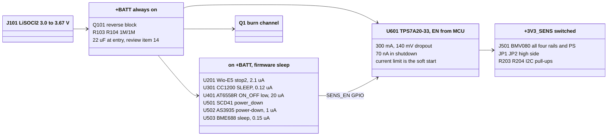

# Power options: as built vs. LDO vs. switched domains

2026-09-22. This compares the board as it stands (everything on the
unregulated `+BATT`) with two alternatives: a single 3.3 V LDO, and an LDO
plus switched domains. The goal is the lowest battery drain for a payload
that wakes up, takes a fix, reads its sensors, transmits one packet and
sleeps again. The numbers come from `tools/power_budget.py` and every
current is a data sheet typical unless it says otherwise.

## Bottom line

1. **An LDO on its own saves nothing.** With a linear regulator the battery
   delivers the load current plus the regulator's own ground current. From
   a 3.6 V cell to a 3.3 V rail it does not reduce current at all. Option B
   comes out 6.5 uA *worse* than the board as built. An LDO fixes voltage
   limits, not consumption.
2. **The drain is in two places, and neither needs a regulator:**
   - **Asleep:** the SCD40 draws 200 uA idle forever. The SCD40 has no
     `power_down` command; only the SCD41 has one. That one part is 74 % of
     the board's 271 uA sleep floor. Next come the BMV080 sleep current
     (< 30 uA) and the 100k/100k battery divider (18 uA).
   - **Awake:** one BMV080 reading costs about 760 mC (68 mA for 11 s).
     That is 75 % of a full wake cycle, more than the GNSS fix, the
     transmit and every other sensor together.
3. **The recommended change (option C)** brings the sleep floor from
   **271 uA to 26 uA**:
   - swap the SCD40 for the SCD41 (same footprint, same data sheet);
   - put the BMV080 behind a 3.3 V LDO whose EN pin is driven by the MCU;
   - raise the divider to 1M/1M.

   The LDO in option C is there because the BMV080 laser rail needs
   3.3 V +-5 %. Its EN pin doubles as the power switch.
4. **FETs on the MCU, the CC1200 or the BME688 are not worth fitting.** They
   already sleep at 2.1, 0.12 and 0.15 uA. A switch would save well under
   1 uA and would add backfeed paths on every signal line.
5. **Switching off the GNSS is optional** (option C+GNSS). It saves 12 uA,
   but only if `VDD_BK` moves to `+BATT` so the receiver keeps its hot
   start. Without that change a cold start costs as much as about 9 hours
   of sleep.

## Where the charge goes

### Sleep floor

| Load | A: as built | C: switched | Notes |
| --- | ---: | ---: | --- |
| Wio-E5 sleep | 2.1 | 2.1 | Seeed module data sheet |
| CC1200 SLEEP | 0.12 | 0.12 | retention on |
| AT6558R, `ON_OFF` low | 20 | 20 | the TCXO and the LNA are off too |
| SCD40 idle / SCD41 `power_down` | **200** | 1 | Sensirion gives no power-down figure; 1 uA is a placeholder |
| AS3935 power-down | 1 | 1 | listening mode is 60 uA, see below |
| BME688 sleep | 0.15 | 0.15 | |
| BMV080 sleep / unpowered | **< 30** | 0 | 30 uA is the data sheet's upper bound |
| `R103`/`R104` divider | **18** | 1.8 | 100k/100k becomes 1M/1M |
| Regulator | - | 0.07 | TPS7A20 in shutdown |
| **Total, uA** | **271** | **26** | |

Option B is A plus 6.5 uA. Option C+GNSS is C minus 20 uA plus 8 uA: it
switches off the GNSS supply and keeps `VDD_BK` alive, for 14 uA in total.

If the lightning detector has to listen for the whole flight, add 59 uA to
every option. That is still the right call if lightning is the point of
the flight, but it becomes the largest single term in option C.

### One wake cycle

| Burst | mA | s | mC |
| --- | ---: | ---: | ---: |
| AT6558R hot fix | 23 | 5 | 115 |
| SCD4x one reading | 15 avg | 5 | 77 |
| BME688 T/P/H and gas heater | 13 | 0.2 | 2.6 |
| CC1200 TX at +14 dBm | 46 | 0.25 | 11.5 |
| BMV080 one duty cycle | < 68 | 11.2 | **760** |
| MCU awake (assumed 4 mA) | 4 | 11.4 | 46 |
| **Total** | | | **1011** (227 without the BMV080) |

The SCD40 costs the same per reading as the SCD41: start periodic
measurement, take the first result at 5 s, stop. The only difference
between them is the idle floor.

```mermaid
gantt
    title One wake cycle, all sensors, seconds
    dateFormat s
    axisFormat %S
    section MCU
    awake, 4 mA              :0, 12
    section GNSS
    hot fix, 23 mA           :0, 5
    section Sensors
    SCD41 single shot, 15 mA :0, 5
    BME688, 13 mA            :0, 1
    BMV080 rail on, 68 mA    :0, 11
    section Radio
    CC1200 TX, 46 mA         :11, 12
```

### Per day

| Scenario | A, mAh/day | B | C | C+GNSS |
| --- | ---: | ---: | ---: | ---: |
| every 10 min, BMV080 every cycle | 47.0 | 47.1 | 41.1 | 40.8 |
| every 10 min, BMV080 once an hour | 20.8 | 21.0 | 14.9 | 14.7 |
| every 60 min, BMV080 every cycle | 13.3 | 13.4 | 7.4 | 7.1 |
| every 60 min, no BMV080 | 8.0 | 8.2 | **2.1** | **1.9** |

The less often the board wakes, the more the sleep floor matters. At one
cycle an hour without the BMV080, option C lasts about 3.8 times as long as
the board as built. At 10 min with the BMV080 every cycle, the sensor's
readings dominate and C saves only 13 %. **After the SCD40 swap, the
biggest lever is how often the BMV080 runs**, and that is a firmware
setting.

## What the LDO does buy

These are voltage problems, not power problems. They are real, and they
decide whether an always-on 3.3 V rail is worth adding on top of option C:

- A fresh LiSOCl2 cell rests near 3.67 V. That is above the 3.6 V operating
  maximum of the Wio-E5, the CC1200, the AS3935 and the BME688, and above
  the BMV080's 3.6 V absolute maximum on every rail.
- The BMV080 laser rail `VDDL` needs 3.135 to 3.465 V. The cell sits in
  that window for only part of its discharge.
- The TCXO (`X401`) is rated to 3.3 V, and `VX_OUT` follows `VDD_IO` up to
  3.6 V.

Costs of an always-on 3.3 V rail from this cell:

- **Dropout.** The cell spends most of its life at 3.3 to 3.6 V and sags
  further under pulses and in the cold. A 3.3 V LDO therefore spends much
  of the flight in dropout, passing the cell through minus 100 to 270 mV.
- **Transmit power.** CC1200 output at the maximum PA setting is about
  15.7 dBm at 3.6 V and 15 dBm at 3.0 V (SWRS123D figure 4-7). A 3.3 V rail
  costs about 0.3 dB. Cold raises output by about the same amount.
- **Current rating.** A TPS7A02 (25 nA Iq, 200 mA) cannot carry the SCD4x's
  205 mA peak on top of anything else. A 300 mA part such as the TPS7A20
  costs 6.5 uA, which is a quarter of option C's floor.

If you want voltage compliance as well, the cheapest route is a TPS7A02-33
(25 nA) as an always-on rail for the Wio-E5, CC1200, GNSS, BME688 and
AS3935. The SCD41 stays on raw `+BATT` (2.4 to 5.5 V is fine), and so does
the burn channel. Firmware must not let the CC1200 transmit and a LoRa
transmit overlap. The simultaneous peak is then about 90 mA (CC1200 TX,
GNSS, MCU, BME688 heater), inside the TPS7A02's 200 mA.

## Proposed architecture (option C)

### Changes

| # | Change | Saves | Parts |
| --- | --- | --- | --- |
| 1 | `U501` SCD40 to SCD41-D-R2 | 199 uA | none; same land pattern |
| 2 | `R103`/`R104` 100k to 1M; keep `C107` 100n so the ADC samples from the capacitor | 16 uA | none |
| 3 | Add a TPS7A20-33 with EN on a spare GPIO. Its output, `+3V3_SENS`, feeds all four BMV080 rails, the BMV080 `PS` pin, the high side of `JP1`/`JP2`, and the I2C pull-ups `R203`/`R204` | up to 30 uA, and `VDDL` in window | 1 LDO, 2 caps |
| 4 | Optional: TPS22917 on the GNSS supply, with `VDD_BK` moved from floating to `+BATT` | 12 uA | 1 switch, 1 cap |
| 5 | Firmware: BMV080 once an hour, not every cycle | 26 mAh/day at a 10 min cycle | none |

At the BMV080's 68 mA the TPS7A20 drops roughly 35 mV (140 mV at 300 mA,
scaled), so `VDDL` stays in window down to a cell of about 3.35 V; below
that the LDO passes the cell through. Change 3 is the only one that needs
a spare Wio-E5 pin. Changes 1 and 2 are
drop-in and remove 80 % of the floor on their own.

## Traps in switching parts off

- **Backfeed through I/O pins.** A chip with its supply off still has ESD
  diodes from every pin to that supply. Any pin held high powers it
  partially, loads the line, and can latch the chip up when its supply
  returns. On this board that means:
  - The I2C pull-ups on `+BATT` would backfeed a switched-off BMV080. That
    is why change 3 moves them onto the switched rail.
  - `JP1`/`JP2` tie their high side to `+BATT`, so they have to move to the
    switched rail as well.
  - `PM_IRQ` has no external pull-up. The MCU's internal pull-up on `PB9`
    must be off while the rail is off.
  - With the pull-ups gone, the MCU should drive `SCL`/`SDA` low while the
    rail is off. Floating inputs on the powered sensors can draw
    shoot-through current. Releasing both lines when the rail comes back is
    a stop condition, which is harmless.
  - If the GNSS is switched off, `PA2` (USART2 TX, idles high) and
    `GNSS_ONOFF` must go low first.
- **BMV080 power-up order.** The data sheet (figure 28) wants `VDDIO` before
  the other rails, and latches `PS` at power-up. Change 3 brings all rails
  up together from one LDO. Confirm that figure 28 permits that. If it does
  not, use a second switch, or an RC on the core rails.
- **Inrush.** Switching 10 uF or more onto a bobbin cell dips `+BATT` and
  can reset the MCU. An LDO's current limit acts as a soft start. A bare
  P-FET does not, which is one more reason to use the LDO's EN pin rather
  than a FET for the BMV080.
- **GNSS hot start.** The receiver keeps its ephemeris in the backup domain.
  With `VDD_BK` floating, that domain is fed from `VDD_IO`, so cutting the
  supply forces a cold start: up to 32 s at 23 mA, which equals about 9 h
  of `ON_OFF` sleep. Either keep `ON_OFF` sleep, or feed `VDD_BK` before
  switching the supply off. Ephemeris goes stale after a few hours anyway,
  so hourly fixes stay hot and six-hourly fixes do not.
- **SCD41 self-calibration.** ASC does not run in power-cycled or
  `power_down` single-shot operation. It needs days of fresh-air exposure,
  so it would not help during a flight anyway. Do a forced recalibration
  on the ground before launch.
- **The cell itself.** A bobbin LiSOCl2 cell is rated for tens of mA
  continuous. The BMV080's 68 mA for 11 s and the SCD4x's 205 mA peaks rely
  on the bulk capacitance and the cell's pulse rating, and both get worse
  in the cold. Neither an LDO nor a switch helps here. A spiral cell or a
  hybrid-layer capacitor does.

## Not verified

- The SCD41 `power_down` current is in no Sensirion document. The budget
  uses 1 uA.
- BMV080 duty-cycle current is given only in mW. The per-reading charge
  here is 68 mA times the 11.2 s window, and it is an upper bound.
- The MCU run current (4 mA) and the packet airtime (0.25 s) are
  assumptions. Both are small terms.
- The Wio-E5 LoRa transmit current was not checked. It matters only for
  sizing an always-on LDO.
- Whether the BMV080's rails may rise together (figure 28).
