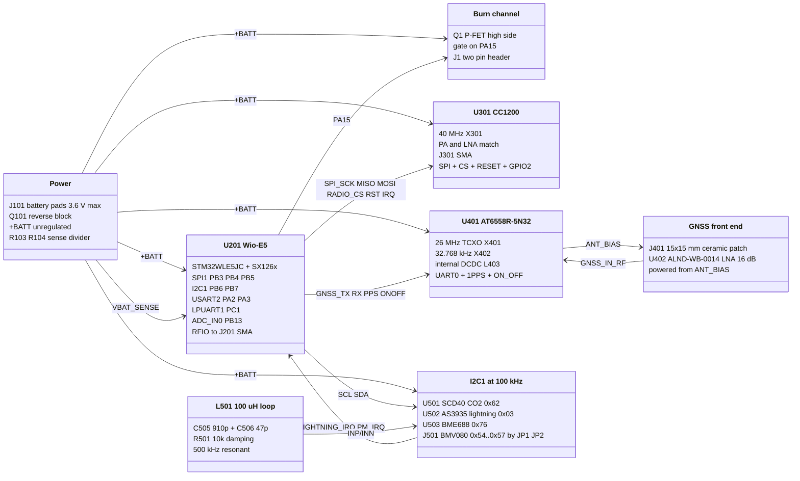

# cc1200-balloon

High altitude balloon payload: a CC1200 sub-GHz telemetry downlink and an air
quality sensor stack, hosted by a Seeed Wio-E5 module. Four-layer 50 x 30 mm
board, routed. The last full review is in `BOARD_REVIEW.md`; read its verdict
table before ordering boards. **Five items in it block fabrication.**

The CC1200 radio and its 434 MHz matching network are carried over from the
v1 design (an import of the Altus Metrum TeleMini netlist). Everything else
is new: the Wio-E5 host, an AT6558R GNSS receiver with an on-board patch
antenna and LNA, a burn/cutdown channel, and the sensor set from
`Forest-Balloon.csv`.

## Architecture



## Sheets

| Sheet | Contents |
| --- | --- |
| `mcu.kicad_sch` | battery pads, reverse-block P-FET, sense divider, Wio-E5 and decoupling, reset, SWD and console pads, status LED, I2C pull-ups, LoRa SMA, burn FET and header, two mounting holes |
| `radio.kicad_sch` | CC1200, 40 MHz crystal, per-pin decoupling, loop filter, the v1 TX/RX matching network, SMA |
| `gnss.kicad_sch` | AT6558R-5N32, 26 MHz TCXO, 32.768 kHz RTC crystal, internal DCDC/LDO passives, ALND-WB-0014 LNA, ceramic patch antenna |
| `sensors.kicad_sch` | SCD40, AS3935 with its 500 kHz loop antenna, one BME688, BMV080 ZIF connector on I2C with address jumpers |

## Power

There is no regulator and no switch. The cell drives the whole board through
one P-channel FET:

```
J101 -- VBATT_IN -- Q101 (reverse block) -- +BATT -- everything
```

`Q101` blocks a reversed cell: its source is on the load side, so the body
diode conducts battery to load and the channel shorts it out. The rail is
the cell minus one Rds(on) and follows the cell from full charge to cutoff.
`R103`/`R104` (100k/100k) put half of it on `PB13` for the ADC.

| | |
| --- | --- |
| Rail | `+BATT`, unregulated, 3.6 V maximum |
| Bulk on the rail | 43.5 uF nominal as drawn, 4.7 uF at the MCU and the GNSS, 10 uF at each of the three big sensor loads, 1 uF at each IC |
| At the battery entry | nothing; nearest is `C202` at 19 mm |
| Off-state drain | none possible: the board is live whenever the cell is connected |

Every supply window on this rail is tabulated in section 4 of the
2026-09-15 review; the BMV080 and the TCXO are the tight ones.

## GNSS front end

The receiver sees a passive 15 x 15 mm ceramic patch (`J401`, The Antenna
Company AC33154-1T) mounted on the back of the board, feeding an Abracon
`ALND-WB-0014` LNA (`U402`, 16 dB, 0.85 dB noise figure) on the front.
`ANT_BIAS` powers the LNA, which puts the LNA's 5.3 mA above the chip's
2.5 mA antenna-detect threshold and switches it off with the receiver in
sleep. `C402` 100 pF blocks DC into `RF_IN`; `L402` 6.8 nH is the series
match at the chip.

`BOARD_REVIEW.md` items 3, 4, 6, 8 and 17 all concern this block. It is not
ready to build.

## Burn channel

`Q1`, a P-channel FET on `PA15`, switches `+BATT` into the two-pin header
`J1` for a cutdown wire. Review items 1, 2 and 15 concern it. It is not
ready to build.

## Wio-E5 pin map

| Pin | Net | Function |
| --- | --- | --- |
| 8 PB3 | `SPI_SCK` | SPI1 clock to the CC1200 |
| 7 PB4 | `SPI_MISO` | SPI1 MISO |
| 11 PB5 | `SPI_MOSI` | SPI1 MOSI |
| 26 PB14 | `RADIO_CS` | CC1200 chip select |
| 5 PB15 | `RADIO_RST` | CC1200 reset |
| 20 PB10 | `RADIO_IRQ` | CC1200 GPIO2 |
| 6 PA15 | `Net-(Q1-G)` | burn FET gate |
| 25 PB9 | `PM_IRQ` | BMV080 interrupt, open drain active low |
| 10 PB6 | `SCL` | I2C1 clock |
| 9 PB7 | `SDA` | I2C1 data |
| 23 PA0 | `LIGHTNING_IRQ` | AS3935 interrupt (wake-capable) |
| 19 PA2 | `GNSS_RX` | USART2 TX to the receiver, through 22R |
| 18 PA3 | `GNSS_TX` | USART2 RX from the receiver, through 22R |
| 27 PA10 | `GNSS_PPS` | 1PPS |
| 13 PC0 | `GNSS_ONOFF` | receiver sleep control |
| 12 PC1 | `DBG_TX` | LPUART1 console out, on the debug pads |
| 24 PB13 | `BATT_VSENSE` | ADC_IN0, 1:2 divider off `+BATT`; also the module's boot pin |
| 21 PA9 | `STATUS_LED` | green LED through 1 k |
| 15 RFIO | `LORA_RF` | `J201`, the module's own sub-GHz radio |

CC1200 GPIO0 and GPIO3 go to test pads `TP301`/`TP302`. GNSS SWD is on
`TP401`/`TP402`.

## Interfaces

| Ref | Part | Carries |
| --- | --- | --- |
| `J101` | two 2 x 4 mm solder pads, 3 mm pitch, back side | battery leads |
| `J202` | six 1.27 mm solder pads, back side | `+BATT` GND SWDIO SWCLK NRST DBG_TX |
| `J1` | 2-pin 1.00 mm header, front side | burn wire, switched high side |
| `J201` `J301` | Samtec SMA-J-P-H-ST-EM1 edge launch | LoRa and CC1200 antennas |
| `J401` | AC33154-1T patch, pin fed through the board | GNSS, back side |
| `J501` | Kyocera 6844 0.30 mm 13-way ZIF | BMV080 flex; the sensor lies along the bottom edge |
| `JP1` `JP2` | 3-pad solder jumpers | BMV080 I2C address bits; open by default, which the sensor does not allow |

## Parts, data sheets and BOM

Most bought symbols carry `Datasheet`, `MPN` and `Manufacturer` fields,
mirrored onto the board's footprints. The sourcing table is
`tools/parts.json`.

```sh
python3 tools/set_part_fields.py --check   # report what would change
python3 tools/set_part_fields.py           # write fields into *.kicad_sch and the .kicad_pcb
python3 tools/gen_digikey_bom.py           # digikey_bom.csv, BOM.md, bom.json
```

**The BOM tools do not currently run.** Six symbols (`Q1`, `J1`, `X401`,
`U402`, `C416`, `J401`) have no entry in `tools/parts.json`, so
`digikey_bom.csv` and `BOM.md` are stale: they still list three SMA jacks,
an off-board active antenna, the old TCXO and two BME688. Review item 19
lists the DigiKey numbers to add.

## The generator is stale

`sheets/*.json`, `build.sh` and the TypeScript tools describe the design as
it stood on 2026-09-06. The schematics were hand-edited after that and the
board was routed against them. **Do not run `build.sh`**: it would overwrite
all four sheets with the old design. The `.kicad_sch` files are the source
of truth.

## Verification

| Check | Result on 2026-09-20 |
| --- | --- |
| full-hierarchy ERC | 0 errors, 2 warnings (`JP1`/`JP2` differ from the library) |
| DRC, zones refilled, all track errors | 28 unique errors: 13 clearance, 7 starved thermal, 4 courtyard, 3 hole clearance, 1 silk |
| schematic parity | 0 unconnected items, 0 parity issues |
| pinouts vs data sheets | Wio-E5, CC1200, AT6558R, AS3935, BME688, SCD40, BMV080, ALND-WB-0014, NSC5351B: match. `Q1` does not |

## Known limitations

- **The rail is unregulated and can touch 3.6 V**, the absolute maximum
  operating supply of the Wio-E5 and the CC1200. Confirm the cell's
  open-circuit voltage before connecting it.
- **No brownout floor.** RF output power, the ADC reference and sensor
  readings drift with the cell. `BATT_VSENSE` makes the drift observable.
- **The GNSS stops first.** `VDD_IO` and `DX_IN` are specified from 2.7 V;
  the TCXO is rated to 3.3 V and is fed from a pin that can reach 3.6 V.
  Budget the flight on that, not on the cell's cutoff.
- **The BMV080 wants 3.3 V +-5 % on its laser supply.** On this rail it is
  in window only between 3.135 and 3.465 V.
- **The patch antenna is characterized on a 50 x 50 mm ground plane** and has
  0.09 mm of it on one side here. Expect it to be off tune.
- **GNSS altitude limit.** The AT6558R data sheet says nothing about COCOM
  limits; confirm behavior above 18 km before flying.
- **SCD40 in a balloon.** Specified from -10 C and pressure dependent;
  compensate from the BME688 pressure channel.
- **No thermal design, no antenna measurements.** The CC1200 match values
  are TeleMini's; sweep them on this board.
